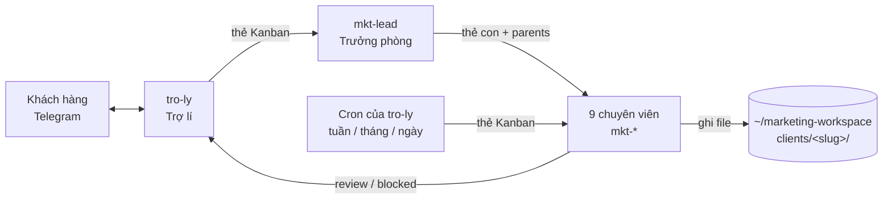

# Kiến trúc

## Tổng quan



Một Hermes instance cho mỗi khách (VPS hoặc container riêng). Trong instance đó:

| Thành phần | Nơi ở | Ai quản lý |
|---|---|---|
| 11 profile (SOUL, skill, config, cron) | `~/.hermes/profiles/<name>/` | Repo này, qua `hermes profile install/update` |
| Key, memory, session | `~/.hermes/profiles/<name>/.env`, `memories/`, `state.db` | Máy của khách, không bao giờ vào git |
| Board Kanban (board `default`) | `~/.hermes/kanban.db` | Hermes |
| Dữ liệu khách | `~/marketing-workspace/` (repo git riêng) | Agent ghi, con người duyệt và commit |
| Gateway (Telegram + cron + dispatcher) | Một process của profile gốc, multiplex mọi profile | `hermes gateway install` |

## Luồng làm việc

Foundation → Research → Strategy → CRO → Execution → Distribution → **khách duyệt** → Performance → Feedback.

1. Khách nhắn `tro-ly`. Skill `marketing-handoff` tạo **một** thẻ cho `mkt-lead` (tenant = slug khách,
   workspace `dir:` tuyệt đối tới thư mục khách).
2. `mkt-lead` chạy `system-state-check`, rồi `marketing-router` tạo các thẻ con với `parents` để giữ thứ tự:
   chưa có `brand.md` thì `brand-setup` đi trước; chưa có research/brief thì thêm vào làm parent.
3. Dispatcher (trong gateway) chạy từng thẻ bằng profile được giao. Worker đọc `brand/brand.md`, làm đúng một
   skill, ghi file vào đường dẫn cố định.
4. Thiếu thông tin → worker `kanban_block` kèm câu hỏi → `tro-ly` (`team-status` / digest hằng ngày) hỏi khách →
   `kanban_comment` + `kanban_unblock`.
5. Sản phẩm gửi khách → `kanban_request_review`. `kanban.review_dispatch: false` nên **không có AI tự duyệt**:
   khách trả lời "duyệt" (Trợ lí chạy `hermes kanban complete`) hoặc yêu cầu sửa (`hermes kanban request-changes`).
6. Cron của `tro-ly`: thứ Hai 8:00 tạo thẻ `weekly-report`; ngày 1 tạo `monthly-performance-review` →
   `foundation-review` (vòng feedback cập nhật `brand.md`); 17:30 các ngày trong tuần gửi digest.

## Nguyên tắc thiết kế

- **`brand/brand.md` là nguồn sự thật duy nhất.** Mọi skill đọc nó trước; chỉ `mkt-brand` ghi, có changelog.
- **Đường dẫn cố định.** Mỗi skill đọc/ghi ở chỗ đã định để skill sau dùng ngay, không cần chuyển đổi.
- **Con người quyết định.** Hệ thống đề xuất; không agent nào đăng bài, gửi email hay chi tiền.
- **Mỗi profile một vai.** Profile là "đảo" độc lập (memory, key riêng); kỹ năng chia theo vai để index ngắn và
  định tuyến chính xác (`hermes profile describe`).
- **Orchestrator không làm thay.** `mkt-lead` chỉ tạo/nối/đóng thẻ (quy ước Kanban của Hermes).

## Kanban cấu hình

Đặt ở profile gốc (gateway gốc chạy dispatcher), `bootstrap.sh` tự làm:

```yaml
kanban:
  auto_decompose: false        # mkt-lead tự chia việc theo luật riêng
  review_dispatch: false       # chỉ con người duyệt
  orchestrator_profile: mkt-lead
  default_assignee: mkt-lead
```

`kanban` toolset được bật cho `mkt-lead` (cli) và `tro-ly` (cli, telegram, cron); worker do dispatcher khởi chạy
tự có công cụ Kanban.

## Từ bản Claude Code (`general-service`)

| Claude Code | Hermes |
|---|---|
| `.claude/agents/*.md` (16 agent) | 11 profile: `SOUL.md` + `config.yaml` + mô tả định tuyến |
| `.claude/commands/**/*.md` (75) | `profiles/*/skills/<nhóm>/<skill>/SKILL.md` (chuẩn Hermes, mô tả ≤ 60 ký tự) |
| `.claude/agent-memory/` | `memories/` riêng mỗi profile (Hermes tự ghi) |
| `CLAUDE.md` | `AGENTS.md` (repo) + `templates/workspace/AGENTS.md` (luật khi chạy) |
| `settings.local.json` env / mcpServers | `env_requires` + `.env` từng profile / `mcp_servers` trong `config.yaml` |
| Orchestrator gọi agent | Thẻ Kanban với `parents`, `skills`, `tenant` |
| Thư mục review | Cột `review` của Kanban |
| `outputs/` | `~/marketing-workspace/clients/<slug>/` |

Đổi tên để tránh trùng: `USP-definition` → `usp-definition`; SEO `keyword-research` → `seo-keyword-research`;
CRO `ab-test-setup` → `cro-ab-test`, Ads → `ads-ab-test`; CRO `sales-page` → `cro-sales-page`;
`objection-handler` → `outreach-objection-handler` / `sales-objection-handler`; Social `video-script` →
`short-video-script`; Sales `case-study` → `sales-case-study`; `monthly-strategy-review` →
`monthly-performance-review` (analyst) / `foundation-review` (brand).
